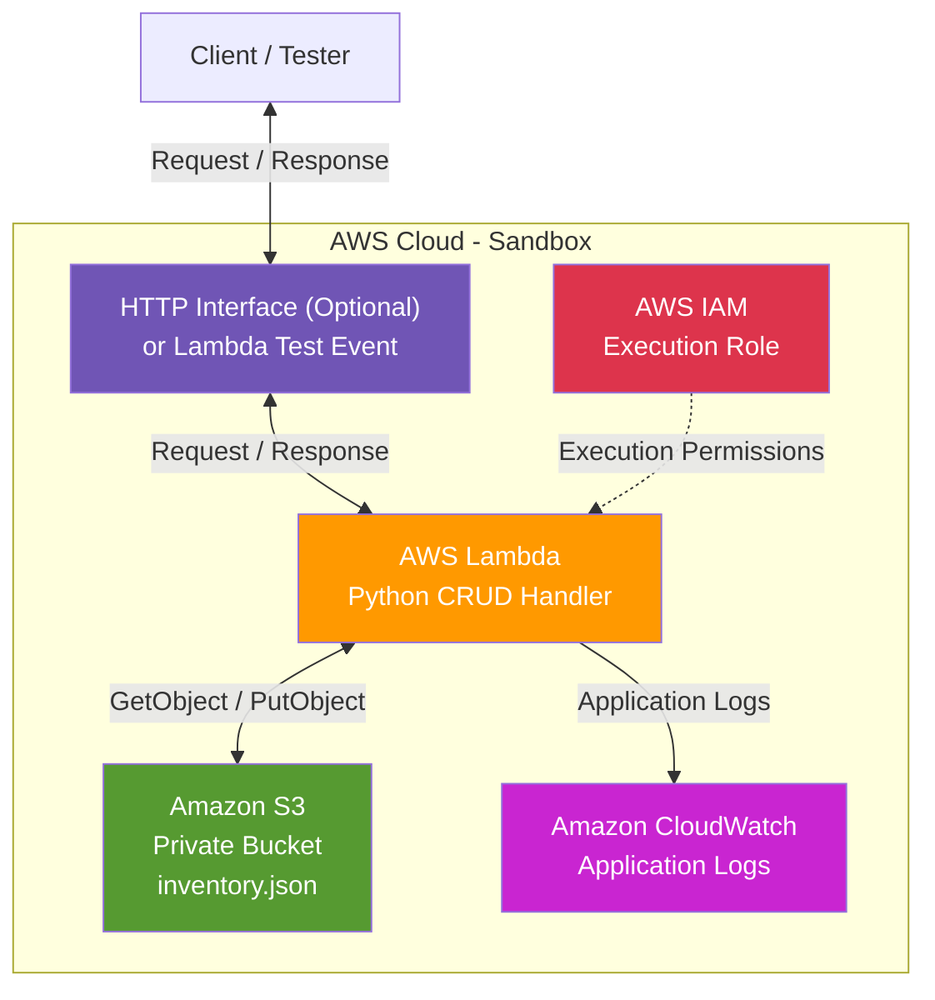

# LabInventory

Sistem Inventaris Barang Laboratorium Berbasis Cloud

## Identitas Pengembang

| Informasi | Keterangan |
|---|---|
| Nama | Aurelia Mutiah Raudyatuzzahra |
| NIM | 24/534903/TK/59310 |
| Mata Kuliah | Cloud Computing |
| Kelas | Teknologi Informasi/B |

## 1. Project Overview

LabInventory merupakan prototipe sistem inventaris
barang laboratorium berbasis cloud yang dikembangkan
untuk memenuhi tugas mata kuliah Cloud Computing.

Sistem dirancang untuk membantu pengelolaan data
barang laboratorium secara terpusat melalui operasi
Create, Read, Update, dan Delete (CRUD).

Pendekatan awal menggunakan arsitektur serverless
pada Amazon Web Services (AWS), dengan konfigurasi
yang akan disesuaikan berdasarkan ketersediaan layanan
pada AWS Academy Cloud Foundations Sandbox.

## 2. Background

Pengelolaan inventaris laboratorium secara manual
dapat menyebabkan kesulitan dalam pencatatan,
pembaruan, dan pemantauan data barang.

LabInventory dirancang sebagai prototipe backend
yang memanfaatkan layanan cloud untuk menjalankan
logika aplikasi dan menyimpan data inventaris.

## 3. Project Objectives

- Mengembangkan backend pengelolaan inventaris.
- Mengimplementasikan empat operasi CRUD.
- Menerapkan validasi data barang.
- Merancang arsitektur cloud yang sederhana.
- Melakukan konfigurasi awal infrastruktur AWS.
- Memverifikasi konektivitas antar layanan cloud.
- Mendokumentasikan proses pengembangan dan pengujian.

## 4. Features

- Menambahkan barang baru.
- Menampilkan seluruh data inventaris.
- Memperbarui informasi barang berdasarkan ID.
- Menghapus barang berdasarkan ID.
- Pembuatan ID barang secara otomatis.
- Validasi atribut barang.
- Penanganan kesalahan aplikasi.
- Penyimpanan data lokal dalam format JSON.
- Adapter penyimpanan Amazon S3.
- Lambda handler untuk pemrosesan request.
- Pengujian otomatis menggunakan unittest.

## 5. Data Model

Sistem menggunakan satu entitas utama, yaitu Barang.

| Attribute | Data Type | Description |
|---|---|---|
| id_barang | String | Identitas unik barang |
| nama_barang | String | Nama barang |
| kategori | String | Kategori barang |
| jumlah | Integer | Jumlah barang, minimal 0 |
| kondisi | String | Kondisi barang |

Nilai kondisi yang diperbolehkan:

- Baik
- Rusak Ringan
- Rusak Berat

Contoh data:

```json
{
    "id_barang": "BRG001",
    "nama_barang": "Arduino Uno",
    "kategori": "Mikrokontroler",
    "jumlah": 15,
    "kondisi": "Baik"
}
```

ID pada contoh merupakan ID data ilustrasi.
Pada operasi create, ID dibuat otomatis oleh aplikasi.

## 6. API Design

| Method | Endpoint | Description | Success Code |
|---|---|---|---|
| POST | /barang | Menambahkan barang | 201 |
| GET | /barang | Menampilkan seluruh barang | 200 |
| PUT | /barang/{id_barang} | Memperbarui barang | 200 |
| DELETE | /barang/{id_barang} | Menghapus barang | 200 |

Pertukaran data menggunakan format JSON.

Operasi PUT memperbarui seluruh atribut barang
dengan mempertahankan ID yang sudah ada.

### Error Handling

| Status Code | Description |
|---|---|
| 400 | Invalid request atau validation error |
| 404 | Barang atau endpoint tidak ditemukan |
| 405 | HTTP method tidak didukung |
| 500 | Internal server atau storage error |

Endpoint tersebut merupakan rancangan routing
aplikasi yang telah diimplementasikan pada Lambda
handler.

Ketersediaan endpoint HTTP aktual bergantung pada
konfigurasi AWS Sandbox.

## 7. Proposed Cloud Architecture



### AWS Services

| Service | Purpose |
|---|---|
| AWS Lambda | Menjalankan logika aplikasi dan CRUD |
| Amazon S3 | Menyimpan data inventaris dalam format JSON |
| AWS IAM | Mengatur izin akses antar layanan |
| Amazon CloudWatch | Mencatat aktivitas dan kesalahan aplikasi |

Arsitektur tersebut masih merupakan rancangan awal.
Pemilihan layanan akan disesuaikan dengan izin
dan fasilitas AWS Academy Sandbox.

## 8. Technology Stack

| Technology | Purpose |
|---|---|
| Python 3.11 | Bahasa pemrograman |
| boto3 | AWS SDK for Python |
| JSON | Format pertukaran dan penyimpanan data |
| unittest | Automated testing |
| Botocore Stubber | Simulasi interaksi AWS SDK |
| Git | Version control |
| GitHub | Remote repository |
| Visual Studio Code | Development environment |
| Mermaid | Architecture documentation |

## 9. Repository Structure

```text
labinventory-cloud/
├── docs/
│   ├── architecture.md
│   ├── deployment-plan.md
│   ├── design-brief.md
│   └── testing-plan.md
├── evidence/
│   └── README.md
├── src/
│   ├── __init__.py
│   ├── inventory.py
│   ├── lambda_function.py
│   ├── s3_storage.py
│   └── storage.py
├── tests/
│   ├── __init__.py
│   ├── sample_data.json
│   ├── test_aws_integration.py
│   └── test_inventory.py
├── .gitignore
├── README.md
└── requirements.txt
```

Folder data lokal, virtual environment, deployment
package, dan screenshot mentah tidak dimasukkan
ke repository.

## 10. Local Setup

### Clone Repository

```bash
git clone https://github.com/aurelia-mutiah/labinventory-cloud.git
cd labinventory-cloud
```

### Create Virtual Environment

```powershell
python -m venv .venv
```

### Activate Virtual Environment

Windows PowerShell:

```powershell
.\.venv\Scripts\Activate.ps1
```

### Install Dependencies

```bash
python -m pip install -r requirements.txt
```

## 11. Running Automated Tests

### Inventory Unit Testing

```bash
python -m unittest tests.test_inventory -v
```

### AWS Integration Simulation

```bash
python -m unittest tests.test_aws_integration -v
```

### Run All Tests

```bash
python -m unittest discover -s tests -v
```

### Local Testing Results

| Test Suite | Total | Passed | Failed |
|---|---:|---:|---:|
| Inventory Unit Testing | 20 | 20 | 0 |
| AWS Integration Simulation | 15 | 15 | 0 |
| Total | 35 | 35 | 0 |

Local testing status: PASSED

Pengujian integrasi lokal menggunakan mock dan
Botocore Stubber sehingga tidak memerlukan
kredensial maupun resource AWS aktual.

Hasil tersebut tidak menunjukkan bahwa deployment
AWS telah berhasil dilakukan.

## 12. Deployment Plan

Deployment direncanakan melalui tahapan berikut:

1. Memeriksa ketersediaan layanan AWS Sandbox.
2. Menentukan region dan konfigurasi yang diizinkan.
3. Membuat bucket Amazon S3.
4. Menginisialisasi objek inventory.json.
5. Menyiapkan deployment package.
6. Membuat AWS Lambda function.
7. Mengatur handler dan environment variables.
8. Mengatur execution role yang diizinkan.
9. Menguji konektivitas Lambda dengan S3.
10. Menguji operasi CRUD.
11. Memeriksa CloudWatch Logs.
12. Mengonfigurasi antarmuka HTTP apabila memungkinkan.
13. Mendokumentasikan hasil implementasi.

Panduan lengkap tersedia pada
[Deployment Plan](docs/deployment-plan.md).

## 13. Security Considerations

- Bucket S3 direncanakan bersifat privat.
- Block Public Access tetap diaktifkan.
- Penyimpanan menggunakan enkripsi bawaan S3.
- Lambda menggunakan execution role yang diizinkan.
- Akses resource dibatasi sesuai kebutuhan aplikasi
  sejauh konfigurasi sandbox memungkinkan.
- Kredensial AWS tidak disimpan pada source code.
- Informasi sensitif tidak diunggah ke GitHub.
- Antarmuka HTTP tidak dibuka tanpa pengamanan
  yang sesuai.

## 14. Project Documentation

| Document | Description |
|---|---|
| [Design Brief](docs/design-brief.md) | Gambaran umum dan ruang lingkup proyek |
| [Architecture Design](docs/architecture.md) | Diagram dan rancangan arsitektur cloud |
| [Deployment Plan](docs/deployment-plan.md) | Rencana konfigurasi infrastruktur |
| [Testing Plan](docs/testing-plan.md) | Skenario dan prosedur pengujian |
| [Evidence Documentation](evidence/README.md) | Panduan pengumpulan bukti |

## 15. Project Progress

- [x] Menentukan studi kasus.
- [x] Menentukan entitas dan model data.
- [x] Merancang empat endpoint CRUD.
- [x] Membuat repository Git.
- [x] Mengimplementasikan logika CRUD.
- [x] Mengimplementasikan penyimpanan lokal.
- [x] Mengimplementasikan adapter Amazon S3.
- [x] Mengimplementasikan Lambda handler.
- [x] Menjalankan pengujian lokal.
- [x] Menyusun design brief awal.
- [x] Menyusun diagram arsitektur awal.
- [x] Menyusun deployment plan.
- [x] Menyusun testing plan.
- [x] Menyiapkan panduan pengumpulan bukti.
- [ ] Memverifikasi layanan AWS Sandbox.
- [ ] Melakukan provisioning infrastruktur.
- [ ] Melakukan deployment aplikasi.
- [ ] Menguji konektivitas AWS.
- [ ] Menguji operasi CRUD pada AWS.
- [ ] Mengumpulkan bukti implementasi AWS.
- [ ] Memfinalisasi dokumentasi.
- [ ] Menyelesaikan laporan akhir.

## 16. Project Limitations

LabInventory merupakan prototipe akademik dan belum
ditujukan untuk penggunaan produksi.

Batasan sistem meliputi:

- Belum memiliki antarmuka pengguna.
- Belum memiliki autentikasi pengguna aplikasi.
- Belum mendukung pengelolaan peminjaman barang.
- Belum menyediakan fitur pelaporan inventaris.
- Penyimpanan menggunakan satu objek JSON sehingga
  belum mendukung concurrent write secara aman.
- Konfigurasi cloud bergantung pada batasan sandbox.

## 17. Current Status

Local Implementation: COMPLETED

Local Automated Testing: PASSED (35/35)

Cloud Architecture: PROPOSED

AWS Deployment: PENDING

Cloud Testing: PENDING

Dokumentasi dan arsitektur akan diperbarui berdasarkan
hasil implementasi aktual pada AWS Academy Sandbox.

---
