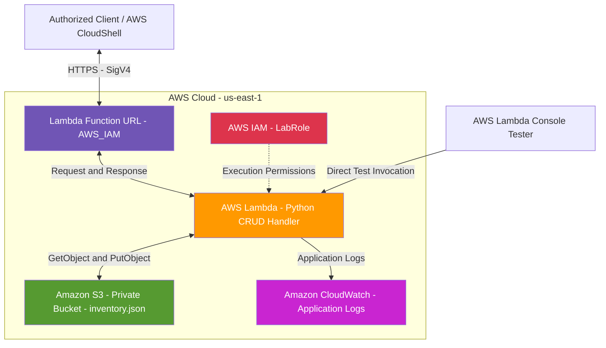

# LabInventory

**Sistem Inventaris Barang Laboratorium Berbasis Cloud**

Prototipe backend berbasis arsitektur serverless menggunakan
AWS Lambda, Amazon S3, AWS IAM, Lambda Function URL,
dan Amazon CloudWatch.


## Identitas Pengembang

| Informasi | Keterangan |
|---|---|
| Nama | Aurelia Mutiah Raudyatuzzahra |
| NIM | 24/534903/TK/59310 |
| Mata Kuliah | Cloud Computing |
| Kelas | Teknologi Informasi/B |

## 1. Project Overview

LabInventory merupakan prototipe sistem inventaris
barang laboratorium berbasis cloud yang dikembangkan
untuk memenuhi tugas mata kuliah Cloud Computing.

Sistem membantu pengelolaan data barang laboratorium
secara terpusat melalui operasi Create, Read, Update,
dan Delete (CRUD).

LabInventory menggunakan arsitektur serverless pada
Amazon Web Services (AWS). Logika aplikasi dijalankan
oleh AWS Lambda, sedangkan data inventaris disimpan
dalam format JSON pada Amazon S3.

Akses HTTPS disediakan melalui Lambda Function URL
dengan autentikasi AWS IAM. Aktivitas aplikasi
dicatat menggunakan Amazon CloudWatch.

Implementasi dan pengujian dilakukan pada AWS Academy
Cloud Foundations Sandbox Lingkungan Hidup.

## 2. Background

Pengelolaan inventaris laboratorium secara manual
dapat menyebabkan kesulitan dalam pencatatan,
pembaruan, dan pemantauan data barang.

Pencatatan yang tidak terpusat juga dapat menyebabkan
ketidaksesuaian informasi mengenai jumlah dan kondisi
barang yang tersedia.

LabInventory dikembangkan sebagai prototipe backend
yang memanfaatkan layanan cloud untuk menjalankan
logika aplikasi dan menyimpan data inventaris.

Pendekatan serverless dipilih agar pengembangan dapat
berfokus pada fungsi aplikasi tanpa harus mengelola
server virtual secara langsung.

## 3. Project Objectives

- Mengembangkan backend pengelolaan inventaris.
- Mengimplementasikan empat operasi CRUD.
- Menerapkan validasi data barang.
- Merancang arsitektur cloud yang sederhana.
- Melakukan provisioning infrastruktur AWS.
- Melakukan deployment aplikasi pada AWS Lambda.
- Mengintegrasikan AWS Lambda dengan Amazon S3.
- Menerapkan konfigurasi keamanan dasar.
- Memverifikasi konektivitas HTTPS terautentikasi.
- Melakukan pengujian lokal dan cloud.
- Mendokumentasikan proses pengembangan dan implementasi.

## 4. Features

### Core Features

- Menambahkan barang baru.
- Menampilkan seluruh data inventaris.
- Memperbarui informasi barang berdasarkan ID.
- Menghapus barang berdasarkan ID.
- Pembuatan ID barang secara otomatis.
- Validasi atribut barang.
- Penanganan kesalahan aplikasi.

### Technical Features

- Penyimpanan data lokal dalam format JSON.
- Adapter penyimpanan Amazon S3.
- AWS Lambda handler untuk pemrosesan request.
- Dukungan HTTP event format versi 1 dan versi 2.
- Lambda Function URL dengan autentikasi AWS_IAM.
- Pencatatan aktivitas melalui Amazon CloudWatch.
- Pengujian otomatis menggunakan unittest.
- Simulasi integrasi AWS menggunakan Botocore Stubber.

## 5. Data Model

Sistem menggunakan satu entitas utama, yaitu Barang.

| Attribute | Data Type | Description |
|---|---|---|
| id_barang | String | Identitas unik yang dibuat otomatis |
| nama_barang | String | Nama barang, tidak boleh kosong |
| kategori | String | Kategori barang, tidak boleh kosong |
| jumlah | Integer | Jumlah barang, minimal 0 |
| kondisi | String | Kondisi barang berdasarkan nilai yang diizinkan |

Nilai kondisi yang diperbolehkan:

- Baik
- Rusak Ringan
- Rusak Berat

Contoh data hasil pengujian:

```json
{
    "id_barang": "BRG-DAC9867BF6AC",
    "nama_barang": "Arduino Uno",
    "kategori": "Mikrokontroler",
    "jumlah": 15,
    "kondisi": "Baik"
}
```

ID barang dibuat secara otomatis oleh aplikasi
dengan format BRG diikuti karakter unik.

Data inventaris disimpan sebagai array JSON
pada objek inventory.json.

Data yang digunakan selama pengujian merupakan
data contoh, bukan data inventaris laboratorium aktual.

## 6. API Design

| Method | Endpoint | Description | Success Code |
|---|---|---|---|
| POST | /barang | Menambahkan barang | 201 |
| GET | /barang | Menampilkan seluruh barang | 200 |
| PUT | /barang/{id_barang} | Memperbarui barang | 200 |
| DELETE | /barang/{id_barang} | Menghapus barang | 200 |

Pertukaran data menggunakan format JSON.

Operasi PUT memperbarui seluruh atribut barang
dengan mempertahankan ID yang sudah ada.

### 6.1 Create Barang

Method: POST

Endpoint: /barang

Request body:

```json
{
    "nama_barang": "Arduino Uno",
    "kategori": "Mikrokontroler",
    "jumlah": 15,
    "kondisi": "Baik"
}
```

Expected status: 201 Created.

ID barang dihasilkan secara otomatis oleh sistem.

### 6.2 Read Barang

Method: GET

Endpoint: /barang

Expected status: 200 OK.

Contoh response ketika inventaris kosong:

```json
{
    "message": "Data inventaris berhasil dibaca.",
    "total": 0,
    "data": []
}
```

### 6.3 Update Barang

Method: PUT

Endpoint: /barang/{id_barang}

Request body:

```json
{
    "nama_barang": "Arduino Uno",
    "kategori": "Mikrokontroler",
    "jumlah": 12,
    "kondisi": "Rusak Ringan"
}
```

Expected status: 200 OK.

ID barang tidak berubah setelah operasi update.

### 6.4 Delete Barang

Method: DELETE

Endpoint: /barang/{id_barang}

Expected status: 200 OK.

Barang dihapus berdasarkan ID yang diberikan.

### 6.5 Error Handling

| Status Code | Description |
|---|---|
| 400 | Invalid request atau validation error |
| 404 | Barang atau endpoint tidak ditemukan |
| 405 | HTTP method tidak didukung |
| 500 | Internal server atau storage error |

Seluruh endpoint telah diimplementasikan pada
Lambda handler.

Operasi CRUD telah diuji melalui Lambda Test Event.
Konektivitas HTTPS aktual telah diverifikasi
menggunakan metode GET melalui Lambda Function URL.

## 7. Cloud Architecture

### 7.1 Architecture Diagram



### 7.2 AWS Services

| Service | Purpose |
|---|---|
| AWS Lambda | Menjalankan logika aplikasi dan operasi CRUD |
| Lambda Function URL | Menyediakan antarmuka HTTPS |
| Amazon S3 | Menyimpan data inventaris dalam format JSON |
| AWS IAM | Mengatur autentikasi dan izin akses layanan |
| Amazon CloudWatch | Mencatat aktivitas dan kesalahan aplikasi |
| AWS CloudShell | Lingkungan pengujian konektivitas HTTPS |

### 7.3 Request and Data Flow

1. Client mengirimkan HTTPS request yang telah
   ditandatangani menggunakan AWS Signature Version 4.
2. Lambda Function URL memproses autentikasi AWS IAM.
3. Request diteruskan kepada AWS Lambda.
4. Lambda memeriksa HTTP method dan endpoint.
5. Lambda melakukan validasi data apabila diperlukan.
6. Lambda membaca atau memperbarui inventory.json
   melalui Amazon S3.
7. Lambda mengembalikan response dalam format JSON.
8. Informasi eksekusi dicatat pada CloudWatch Logs.

Pengujian melalui Lambda Console menggunakan
direct invocation sehingga tidak melewati
Lambda Function URL.

### 7.4 Network Design

Arsitektur menggunakan layanan AWS terkelola
tanpa merancang custom VPC, subnet, atau EC2 instance.

Komunikasi client dengan Function URL menggunakan
HTTPS dan autentikasi AWS IAM.

Akses Lambda terhadap Amazon S3 menggunakan AWS SDK
dan izin dari execution role.

Bucket Amazon S3 tidak dikonfigurasi sebagai
penyimpanan publik.

## 8. Technology Stack

| Technology | Purpose |
|---|---|
| Python 3.11 | Bahasa pemrograman |
| boto3 | AWS SDK for Python |
| JSON | Format pertukaran dan penyimpanan data |
| unittest | Automated testing |
| unittest.mock | Simulasi komponen aplikasi |
| Botocore Stubber | Simulasi interaksi AWS SDK |
| AWS Lambda | Serverless compute |
| Amazon S3 | Cloud object storage |
| AWS IAM | Authentication and access control |
| Amazon CloudWatch | Application monitoring |
| Git | Version control |
| GitHub | Remote repository |
| Visual Studio Code | Development environment |
| Mermaid | Architecture documentation |

## 9. Repository Structure

```text
labinventory-cloud/
├── docs/
│   ├── architecture.md
│   ├── deployment-plan.md
│   ├── design-brief.md
│   └── testing-plan.md
├── evidence/
│   └── README.md
├── src/
│   ├── __init__.py
│   ├── inventory.py
│   ├── lambda_function.py
│   ├── s3_storage.py
│   └── storage.py
├── tests/
│   ├── __init__.py
│   ├── sample_data.json
│   ├── test_aws_integration.py
│   └── test_inventory.py
├── .gitignore
├── README.md
└── requirements.txt
```

### Source Code Description

| File | Description |
|---|---|
| src/inventory.py | Logika bisnis, validasi, dan operasi CRUD |
| src/storage.py | Adapter penyimpanan JSON lokal |
| src/s3_storage.py | Adapter penyimpanan Amazon S3 |
| src/lambda_function.py | Routing request dan Lambda handler |
| tests/test_inventory.py | Pengujian logika inventaris |
| tests/test_aws_integration.py | Simulasi integrasi AWS dan Lambda handler |
| tests/sample_data.json | Contoh data inventaris |
| requirements.txt | Daftar dependensi Python |

Folder data lokal, virtual environment, deployment
package, Python cache, dan screenshot mentah
dikecualikan dari repository melalui .gitignore.

## 10. Local Setup

### 10.1 Prerequisites

- Python 3.11.
- Git.
- Visual Studio Code atau text editor lainnya.
- Terminal atau PowerShell.

### 10.2 Clone Repository

```bash
git clone https://github.com/aurelia-mutiah/labinventory-cloud.git
cd labinventory-cloud
```

### 10.3 Create Virtual Environment

```powershell
python -m venv .venv
```

### 10.4 Activate Virtual Environment

Windows PowerShell:

```powershell
.\.venv\Scripts\Activate.ps1
```

### 10.5 Install Dependencies

```bash
python -m pip install -r requirements.txt
```

### 10.6 Verify Python Environment

```bash
python --version
python -m pip show boto3
```

Pengujian lokal tidak memerlukan kredensial AWS
atau resource cloud aktual.

## 11. Running Automated Tests

### 11.1 Inventory Unit Testing

```bash
python -m unittest tests.test_inventory -v
```

### 11.2 AWS Integration Simulation

```bash
python -m unittest tests.test_aws_integration -v
```

### 11.3 Run All Tests

```bash
python -m unittest discover -s tests -v
```

### 11.4 Local Testing Results

| Test Suite | Total | Passed | Failed |
|---|---:|---:|---:|
| Inventory Unit Testing | 20 | 20 | 0 |
| AWS Integration Simulation | 15 | 15 | 0 |
| Total | 35 | 35 | 0 |

**Local Testing Status: PASSED**

Seluruh 35 pengujian otomatis lokal berhasil.

Pengujian integrasi lokal menggunakan mock dan
Botocore Stubber sehingga tidak memerlukan
resource AWS aktual.

Keberhasilan deployment AWS diverifikasi melalui
pengujian cloud yang dilakukan secara terpisah.

## 12. AWS Deployment

### 12.1 Deployment Environment

| Parameter | Actual Configuration |
|---|---|
| Environment | AWS Academy Cloud Foundations Sandbox Lingkungan Hidup |
| Region | US East (N. Virginia) |
| Region Code | us-east-1 |
| Lambda Function | labinventory-crud |
| Runtime | Python 3.11 |
| Architecture | x86_64 |
| Memory | 128 MB |
| Timeout | 15 seconds |
| Handler | src.lambda_function.lambda_handler |
| Execution Role | LabRole |
| S3 Bucket | labinventory-534903-20261125 |
| S3 Object | inventory.json |
| HTTP Interface | Lambda Function URL |
| HTTP Authentication | AWS_IAM |
| Invoke Mode | BUFFERED |
| Monitoring | Amazon CloudWatch |

### 12.2 Environment Variables

| Variable | Value |
|---|---|
| BUCKET_NAME | labinventory-534903-20261125 |
| OBJECT_KEY | inventory.json |

### 12.3 Deployment Package

Deployment package berisi folder src pada root
arsip ZIP.

Pembuatan package menggunakan Windows PowerShell:

```powershell
Compress-Archive -Path .\src -DestinationPath .\labinventory-deployment.zip -Force
```

Package kemudian diunggah melalui AWS Lambda Console.

### 12.4 Deployment Procedure

Tahapan deployment yang telah dilakukan:

1. Memeriksa lingkungan AWS Academy Sandbox.
2. Menggunakan region us-east-1.
3. Membuat bucket Amazon S3.
4. Menginisialisasi objek inventory.json.
5. Menyiapkan deployment package.
6. Membuat AWS Lambda function.
7. Mengunggah source code aplikasi.
8. Mengatur runtime, handler, memory, dan timeout.
9. Mengatur environment variables.
10. Menggunakan execution role LabRole.
11. Menguji konektivitas Lambda dengan Amazon S3.
12. Menguji operasi CRUD dan validasi.
13. Memeriksa CloudWatch Logs.
14. Mengonfigurasi Lambda Function URL.
15. Menguji HTTPS melalui AWS CloudShell.
16. Memverifikasi isi akhir objek inventory.json.

Panduan lengkap tersedia pada
[Deployment Plan](docs/deployment-plan.md).

## 13. Cloud Testing Results

### 13.1 Functional Testing

| ID | Test Scenario | Expected Status | Actual Status | Result |
|---|---|---:|---:|---|
| CT-01 | Initial inventory connectivity | 200 | 200 | PASS |
| CT-02 | Create barang | 201 | 201 | PASS |
| CT-03 | Read barang | 200 | 200 | PASS |
| CT-04 | Update barang | 200 | 200 | PASS |
| CT-05 | Verify updated data | 200 | 200 | PASS |
| CT-06 | Delete barang | 200 | 200 | PASS |
| CT-07 | Read after delete | 200 | 200 | PASS |
| CT-08 | Invalid quantity | 400 | 400 | PASS |
| CT-09 | Delete barang not found | 404 | 404 | PASS |

**AWS Functional Testing Status: PASSED**

Total: 9/9 test scenarios passed.

Status 400 dan 404 merupakan hasil yang diharapkan
pada skenario negative testing.

Pengujian dilakukan melalui Lambda Test Event.

### 13.2 Data Persistence Verification

Data awal pada Amazon S3:

```json
[]
```

Data hasil operasi Create:

```json
[
    {
        "id_barang": "BRG-DAC9867BF6AC",
        "nama_barang": "Arduino Uno",
        "kategori": "Mikrokontroler",
        "jumlah": 15,
        "kondisi": "Baik"
    }
]
```

Data setelah operasi Update:

```json
[
    {
        "id_barang": "BRG-DAC9867BF6AC",
        "nama_barang": "Arduino Uno",
        "kategori": "Mikrokontroler",
        "jumlah": 12,
        "kondisi": "Rusak Ringan"
    }
]
```

Data akhir setelah operasi Delete:

```json
[]
```

Data hasil Create dan Update berhasil dibaca kembali
melalui Lambda.

Isi akhir objek inventory.json pada Amazon S3
telah diperiksa secara langsung dan kembali
berupa array kosong.

### 13.3 HTTP Connectivity Testing

Lambda Function URL telah dikonfigurasi dengan
autentikasi AWS_IAM.

Pengujian dilakukan melalui AWS CloudShell
menggunakan Python, boto3, dan AWS Signature Version 4.

Request:

```text
Method: GET
Path: /barang
Authentication: AWS Signature Version 4
```

Actual result:

```text
HTTP Status: 200
```

Response:

```json
{
    "message": "Data inventaris berhasil dibaca.",
    "total": 0,
    "data": []
}
```

**HTTP Connectivity Status: PASSED**

Pengujian HTTPS aktual dilakukan pada metode GET.

Metode POST, PUT, dan DELETE telah diuji melalui
Lambda Test Event, tetapi belum diuji secara
langsung melalui Function URL.

Alamat Function URL tidak dicantumkan pada
repository publik.

Ketersediaan endpoint bergantung pada resource
dan sesi AWS Academy Sandbox.

### 13.4 Monitoring Verification

CloudWatch log group:

```text
/aws/lambda/labinventory-crud
```

CloudWatch berhasil mencatat:

- Informasi request aplikasi.
- Informasi eksekusi Lambda.
- START, END, dan REPORT.
- Durasi eksekusi.
- Penggunaan memori.

**Monitoring Verification Status: PASSED**

## 14. Security Considerations

Konfigurasi keamanan yang digunakan:

| Security Aspect | Implementation |
|---|---|
| S3 Public Access | Block All Public Access aktif |
| S3 Encryption | SSE-S3 |
| Lambda Execution Role | LabRole |
| HTTP Authentication | AWS_IAM |
| Data in Transit | HTTPS |
| Credentials | Tidak ditanamkan pada source code |
| Raw Screenshots | Dikecualikan melalui .gitignore |

Lambda menggunakan execution role yang disediakan
oleh AWS Academy Sandbox.

Role tersebut memungkinkan Lambda mengakses Amazon S3
dan menghasilkan CloudWatch Logs.

Implementasi menggunakan izin yang tersedia pada
lingkungan sandbox dan belum menerapkan custom
least-privilege IAM policy secara penuh.

Kredensial AWS, session token, private key,
dan informasi autentikasi lainnya tidak boleh
disimpan atau dibagikan melalui repository.

## 15. Project Documentation

| Document | Description |
|---|---|
| [Design Brief](docs/design-brief.md) | Gambaran umum, tujuan, dan ruang lingkup proyek |
| [Architecture Design](docs/architecture.md) | Diagram dan konfigurasi arsitektur cloud |
| [Deployment Plan](docs/deployment-plan.md) | Prosedur provisioning dan deployment AWS |
| [Testing Plan](docs/testing-plan.md) | Skenario dan hasil pengujian |
| [Evidence Documentation](evidence/README.md) | Indeks bukti pengembangan dan implementasi |

Sebanyak 29 screenshot teknis telah dikumpulkan
untuk mendokumentasikan pengembangan, provisioning,
deployment, konfigurasi, dan hasil pengujian.

Screenshot mentah disimpan secara lokal dan tidak
dimasukkan ke repository publik.

## 16. Project Progress

### Planning and Design

- [x] Menentukan studi kasus.
- [x] Menentukan entitas dan model data.
- [x] Merancang empat endpoint CRUD.
- [x] Menentukan arsitektur cloud.
- [x] Menyusun design brief.
- [x] Menyusun deployment plan.
- [x] Menyusun testing plan.

### Local Development

- [x] Membuat repository Git.
- [x] Mengimplementasikan logika CRUD.
- [x] Mengimplementasikan penyimpanan lokal.
- [x] Mengimplementasikan adapter Amazon S3.
- [x] Mengimplementasikan Lambda handler.
- [x] Menyiapkan sample data.
- [x] Menjalankan 35 pengujian otomatis lokal.

### AWS Implementation

- [x] Memverifikasi lingkungan AWS Sandbox.
- [x] Membuat bucket Amazon S3.
- [x] Menginisialisasi objek inventory.json.
- [x] Membuat AWS Lambda function.
- [x] Melakukan deployment source code.
- [x] Mengatur konfigurasi Lambda.
- [x] Mengatur environment variables.
- [x] Menggunakan IAM execution role.
- [x] Menguji konektivitas Lambda dengan S3.
- [x] Menguji seluruh operasi CRUD.
- [x] Menguji validasi dan error handling.
- [x] Memverifikasi persistensi data.
- [x] Mengonfigurasi Lambda Function URL.
- [x] Menguji konektivitas HTTPS.
- [x] Memverifikasi CloudWatch Logs.
- [x] Memverifikasi konfigurasi keamanan dasar S3.

### Documentation and Submission

- [x] Mengumpulkan 29 screenshot teknis.
- [x] Memperbarui architecture documentation.
- [x] Memperbarui design brief.
- [x] Memperbarui deployment plan.
- [x] Memperbarui testing plan.
- [x] Memperbarui evidence documentation.
- [x] Memperbarui README utama.
- [ ] Melakukan pemeriksaan akhir repository.
- [ ] Melakukan final commit dan push.
- [ ] Mengumpulkan bukti repository final.
- [ ] Menyelesaikan laporan pengumpulan.

## 17. Project Limitations

LabInventory merupakan prototipe akademik dan belum
ditujukan untuk penggunaan produksi.

Batasan sistem meliputi:

- Belum memiliki antarmuka pengguna.
- Belum memiliki autentikasi pengguna pada level aplikasi.
- Belum mendukung pengelolaan peminjaman barang.
- Belum menyediakan fitur pelaporan inventaris.
- Penyimpanan menggunakan satu objek JSON.
- Concurrent write belum ditangani secara aman.
- Belum dilakukan load testing.
- Belum dilakukan performance benchmarking.
- Belum dilakukan penetration testing.
- Belum dilakukan audit least-privilege IAM secara penuh.
- Pengujian HTTPS aktual baru mencakup metode GET.
- Konfigurasi cloud bergantung pada batasan sandbox.

Penggunaan satu objek JSON dipilih untuk menjaga
kesederhanaan implementasi prototipe.

Pada lingkungan produksi, penyimpanan dapat
dikembangkan menggunakan Amazon DynamoDB atau
database lain yang mendukung pengelolaan data
secara lebih granular.

## 18. Future Improvements

Pengembangan selanjutnya dapat mencakup:

- Penggunaan Amazon DynamoDB sebagai database.
- Pengembangan antarmuka pengguna berbasis web.
- Autentikasi dan otorisasi pengguna aplikasi.
- Role-based access control.
- Pencarian dan filter data inventaris.
- Fitur peminjaman dan pengembalian barang.
- Riwayat perubahan data.
- Pelaporan inventaris.
- Infrastructure as Code.
- Automated CI/CD pipeline.
- Pengujian keamanan dan performa.
- Penerapan IAM least privilege.

Fitur tersebut merupakan usulan pengembangan
dan belum termasuk dalam implementasi aktual.

## 19. Current Status

| Component | Status |
|---|---|
| Local Implementation | COMPLETED |
| Local Automated Testing | PASSED - 35/35 |
| Cloud Architecture | IMPLEMENTED |
| AWS Provisioning | COMPLETED |
| AWS Deployment | COMPLETED |
| AWS Functional Testing | PASSED - 9/9 |
| S3 Persistence Verification | PASSED |
| HTTP Connectivity | PASSED - HTTP 200 |
| CloudWatch Monitoring | VERIFIED |
| Basic S3 Security | VERIFIED |
| Technical Evidence | COLLECTED - 29 screenshots |
| Final Repository Review | IN PROGRESS |
| Final Report | IN PROGRESS |

**Technical Project Status: IMPLEMENTED AND TESTED**

LabInventory telah berhasil diimplementasikan
sebagai prototipe sistem inventaris berbasis cloud.

AWS Lambda berhasil menjalankan logika aplikasi
dan terintegrasi dengan Amazon S3 untuk melakukan
operasi Create, Read, Update, dan Delete.

Lambda Function URL menyediakan akses HTTPS
terautentikasi, sedangkan Amazon CloudWatch
mendukung pencatatan aktivitas aplikasi.

Seluruh pengujian lokal dan skenario pengujian
fungsional cloud yang dilaksanakan memperoleh
hasil sesuai dengan expected result.

Implementasi telah memenuhi target teknis
prototipe akademik dengan batasan yang
didokumentasikan.

---

## Repository

https://github.com/aurelia-mutiah/labinventory-cloud

Developed for Cloud Computing coursework.
