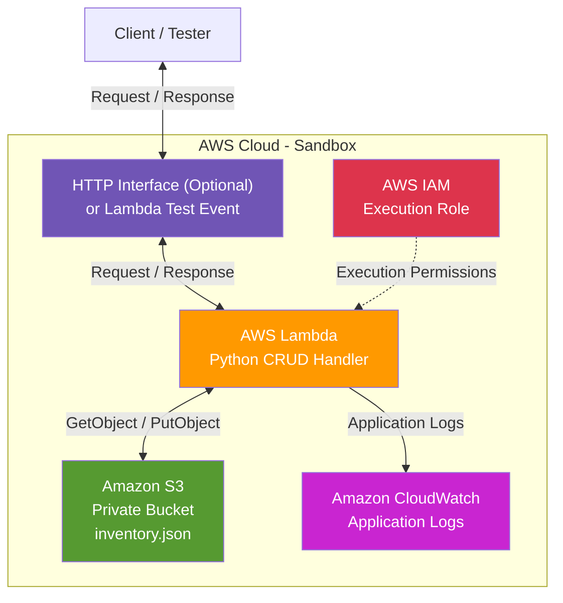

# Architecture Design — LabInventory

## 1. Architecture Overview

LabInventory dirancang menggunakan pendekatan awal
serverless architecture pada Amazon Web Services (AWS).

Arsitektur memisahkan logika aplikasi, penyimpanan data,
pengaturan izin akses, dan pencatatan aktivitas.

Rancangan ini masih bersifat sementara dan akan
disesuaikan dengan ketersediaan layanan pada AWS
Academy Cloud Foundations Sandbox.

## 2. Architecture Diagram

## 3. AWS Service Responsibilities

| Service | Responsibility |
|---|---|
| AWS Lambda | Menjalankan logika CRUD dan validasi data |
| Amazon S3 | Menyimpan data inventaris dalam format JSON |
| AWS IAM | Mengatur izin akses antar layanan |
| Amazon CloudWatch | Menyimpan log aktivitas dan kesalahan |

## 4. Request Flow

1. Client mengirimkan permintaan melalui antarmuka
   HTTP yang tersedia atau Lambda test event.
2. Lambda menerima dan memproses request.
3. Lambda menentukan operasi berdasarkan method
   dan endpoint.
4. InventoryService menjalankan logika CRUD.
5. S3Storage membaca atau memperbarui inventory.json.
6. Lambda mengembalikan response dalam format JSON.
7. Log aplikasi dicatat melalui CloudWatch apabila
   execution role memiliki izin yang diperlukan.

## 5. Data Flow

### Create - POST /barang

- Menerima data barang baru.
- Memvalidasi atribut barang.
- Membuat ID barang secara otomatis.
- Membaca data inventaris dari S3.
- Menambahkan barang ke dalam daftar.
- Menyimpan kembali inventory.json.
- Mengembalikan status 201.

### Read - GET /barang

- Membaca inventory.json dari S3.
- Mengembalikan daftar barang.
- Mengembalikan status 200.

### Update - PUT /barang/{id_barang}

- Membaca data inventaris.
- Mencari barang berdasarkan ID.
- Memvalidasi data pembaruan.
- Memperbarui atribut barang.
- Menyimpan kembali data ke S3.
- Mengembalikan status 200.

### Delete - DELETE /barang/{id_barang}

- Membaca data inventaris.
- Mencari barang berdasarkan ID.
- Menghapus barang dari daftar.
- Menyimpan kembali data ke S3.
- Mengembalikan status 200.

## 6. Security Architecture

- Bucket S3 direncanakan bersifat privat.
- S3 Block Public Access tetap diaktifkan.
- Penyimpanan menggunakan enkripsi bawaan S3.
- Lambda menggunakan execution role yang diizinkan
  oleh lingkungan sandbox.
- Izin akses S3 dibatasi sesuai kebutuhan aplikasi
  sejauh konfigurasi sandbox memungkinkan.
- Kredensial AWS tidak disimpan dalam source code.
- Kredensial dan informasi sensitif tidak diunggah
  ke repository GitHub.
- Antarmuka HTTP tidak direncanakan terbuka tanpa
  mekanisme pengamanan yang sesuai.

## 7. Network Architecture

Rancangan awal tidak menggunakan custom VPC,
subnet, NAT Gateway, atau Internet Gateway.

Lambda direncanakan berjalan menggunakan konfigurasi
jaringan bawaan AWS tanpa koneksi ke VPC milik pengguna.

Komunikasi Lambda dengan Amazon S3 dilakukan melalui
AWS SDK for Python (boto3) menggunakan HTTPS dan
execution role yang tersedia.

Region AWS akan disesuaikan dengan lingkungan sandbox.
Lambda dan S3 direncanakan berada pada region yang sama.

## 8. Architecture Limitations

- Ketersediaan layanan AWS belum diverifikasi.
- Mekanisme akses HTTP belum ditentukan secara final.
- Konfigurasi IAM mengikuti batasan sandbox.
- Penyimpanan satu objek JSON belum mendukung
  concurrent write secara aman.
- Sistem belum ditujukan untuk penggunaan produksi.

## 9. Alternative Architecture

Apabila terdapat keterbatasan layanan pada sandbox,
arsitektur dapat disesuaikan tanpa mengubah tujuan
utama sistem inventaris.

Alternatif akan ditentukan berdasarkan layanan yang
tersedia, izin akses, biaya penggunaan, dan kebutuhan
pengujian.

Setiap perubahan arsitektur akan diikuti dengan
penyesuaian source code, deployment plan, testing plan,
design brief, dan dokumentasi repository.

## 10. Implementation Status

Status: Proposed Architecture

Implementasi lokal telah dikembangkan dan diuji.
Provisioning dan pengujian infrastruktur AWS belum
dilaksanakan.
