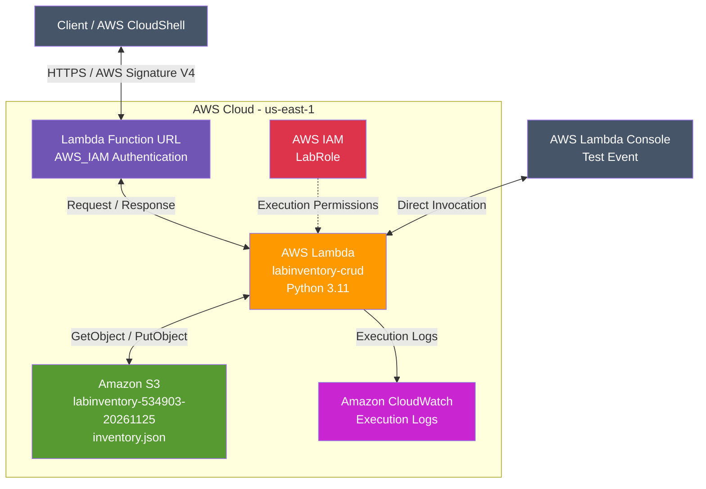

# Architecture Design — LabInventory

## 1. Architecture Overview

LabInventory merupakan sistem inventaris barang laboratorium
berbasis cloud yang mengimplementasikan pendekatan serverless
architecture pada Amazon Web Services (AWS).

Arsitektur memisahkan antarmuka akses, logika aplikasi,
penyimpanan data, pengaturan izin akses, dan pencatatan
aktivitas sistem.

Implementasi dilakukan menggunakan AWS Academy Cloud
Foundations Sandbox Lingkungan Hidup pada region
US East (N. Virginia), us-east-1.

Sistem menyediakan empat operasi utama, yaitu Create,
Read, Update, dan Delete (CRUD) terhadap entitas Barang.

## 2. Architecture Diagram

Diagram menunjukkan dua mekanisme akses terhadap aplikasi,
yaitu melalui Lambda Function URL dengan autentikasi AWS IAM
dan melalui Lambda Test Event untuk pengujian langsung.

AWS Lambda berperan sebagai komponen utama yang menjalankan
logika aplikasi, mengakses penyimpanan Amazon S3, dan
menghasilkan log eksekusi melalui Amazon CloudWatch.

## 3. AWS Service Responsibilities

| Service | Responsibility |
|---|---|
| Lambda Function URL | Menyediakan antarmuka HTTPS untuk mengakses aplikasi |
| AWS Lambda | Menjalankan logika CRUD, routing, dan validasi data |
| Amazon S3 | Menyimpan data inventaris dalam format JSON |
| AWS IAM | Mengatur autentikasi dan izin akses terhadap layanan AWS |
| Amazon CloudWatch | Menyimpan log aktivitas dan informasi eksekusi Lambda |
| AWS CloudShell | Lingkungan pengujian konektivitas HTTP menggunakan kredensial sesi AWS |

## 4. Infrastructure Configuration

### 4.1 AWS Environment

| Configuration | Value |
|---|---|
| Environment | AWS Academy Cloud Foundations Sandbox Lingkungan Hidup |
| Region | US East (N. Virginia) |
| Region code | us-east-1 |
| Architecture approach | Serverless |

### 4.2 AWS Lambda

| Configuration | Value |
|---|---|
| Function name | labinventory-crud |
| Runtime | Python 3.11 |
| Architecture | x86_64 |
| Memory | 128 MB |
| Timeout | 15 seconds |
| Ephemeral storage | 512 MB |
| Handler | src.lambda_function.lambda_handler |
| Execution role | LabRole |
| Deployment method | ZIP package |

### 4.3 Amazon S3

| Configuration | Value |
|---|---|
| Bucket name | labinventory-534903-20261125 |
| Region | us-east-1 |
| Object key | inventory.json |
| Data format | JSON |
| Storage class | Standard |
| Public access | Blocked |
| Default encryption | SSE-S3 |

### 4.4 Lambda Environment Variables

| Key | Value |
|---|---|
| BUCKET_NAME | labinventory-534903-20261125 |
| OBJECT_KEY | inventory.json |

Environment variables digunakan untuk memisahkan konfigurasi
penyimpanan dari source code aplikasi.

### 4.5 Lambda Function URL

| Configuration | Value |
|---|---|
| Authentication type | AWS_IAM |
| Invoke mode | BUFFERED |
| Protocol | HTTPS |
| CORS | Not enabled |
| Request authentication | AWS Signature Version 4 |

Function URL menyediakan akses HTTP langsung terhadap
Lambda tanpa memerlukan Amazon API Gateway.

Alamat Function URL tidak dicantumkan dalam dokumentasi
repository publik.

### 4.6 Amazon CloudWatch

| Configuration | Value |
|---|---|
| Log group | /aws/lambda/labinventory-crud |
| Log class | Standard |
| Log source | AWS Lambda |
| Retention | Never expire (default saat pengujian) |

CloudWatch digunakan untuk memantau aktivitas request,
durasi eksekusi, penggunaan memori, dan informasi
kesalahan aplikasi.

## 5. Request Flow

### 5.1 HTTP Request Flow

1. Client mengirimkan request HTTPS melalui Lambda Function URL.
2. Request ditandatangani menggunakan AWS Signature Version 4.
3. AWS melakukan autentikasi dan otorisasi berdasarkan IAM.
4. Lambda menerima request dalam format event HTTP.
5. Lambda menentukan operasi berdasarkan HTTP method dan path.
6. InventoryService menjalankan logika bisnis dan validasi data.
7. S3Storage membaca atau memperbarui inventory.json melalui boto3.
8. Lambda menghasilkan response dalam format JSON.
9. Function URL meneruskan HTTP response kepada client.
10. Informasi eksekusi Lambda dicatat melalui CloudWatch.

### 5.2 Direct Invocation Flow

1. Tester membuka AWS Lambda Console.
2. Tester menjalankan Lambda Test Event.
3. Lambda menerima event yang merepresentasikan HTTP request.
4. Lambda menjalankan operasi CRUD sesuai event.
5. Lambda mengakses data inventaris pada Amazon S3.
6. Hasil eksekusi ditampilkan pada Lambda Console.
7. Log eksekusi dicatat melalui CloudWatch.

Direct invocation digunakan untuk menguji seluruh operasi
CRUD dan penanganan kesalahan aplikasi.

## 6. Data Flow

### 6.1 Create — POST /barang

- Menerima data barang baru.
- Memvalidasi atribut barang.
- Membaca daftar inventaris dari Amazon S3.
- Membuat ID barang secara otomatis.
- Menambahkan barang ke dalam daftar inventaris.
- Menyimpan kembali inventory.json menggunakan PutObject.
- Mengembalikan status 201 Created.

### 6.2 Read — GET /barang

- Membaca inventory.json menggunakan GetObject.
- Mengambil daftar barang dan jumlah data inventaris.
- Mengembalikan data dalam format JSON.
- Mengembalikan status 200 OK.

### 6.3 Update — PUT /barang/{id_barang}

- Menerima ID barang dan data pembaruan.
- Memvalidasi atribut data pembaruan.
- Membaca daftar inventaris dari Amazon S3.
- Mencari barang berdasarkan ID.
- Memperbarui atribut barang dengan mempertahankan ID.
- Menyimpan kembali inventory.json menggunakan PutObject.
- Mengembalikan status 200 OK.

### 6.4 Delete — DELETE /barang/{id_barang}

- Menerima ID barang yang akan dihapus.
- Membaca daftar inventaris dari Amazon S3.
- Mencari barang berdasarkan ID.
- Menghapus barang dari daftar inventaris.
- Menyimpan kembali inventory.json menggunakan PutObject.
- Mengembalikan status 200 OK.

Operasi Delete menghapus entitas barang dari isi file JSON,
bukan menghapus objek inventory.json dari bucket S3.

## 7. Security Architecture

### 7.1 Authentication and Authorization

Lambda Function URL menggunakan AWS_IAM sebagai mekanisme
autentikasi dan otorisasi.

Pengujian HTTP dilakukan menggunakan AWS CloudShell dengan
request yang ditandatangani melalui AWS Signature Version 4
dan kredensial sesi AWS yang tersedia.

Function URL tidak dikonfigurasi menggunakan autentikasi NONE,
sehingga akses tidak dibuka secara bebas tanpa autentikasi.

### 7.2 IAM Execution Role

AWS Lambda menggunakan LabRole yang telah disediakan oleh
lingkungan AWS Academy Sandbox.

Role tersebut memungkinkan Lambda mengakses Amazon S3 dan
menghasilkan log eksekusi melalui Amazon CloudWatch.

Operasi utama yang dibutuhkan aplikasi meliputi:

- s3:GetObject
- s3:PutObject
- logs:CreateLogGroup
- logs:CreateLogStream
- logs:PutLogEvents

LabRole merupakan role bawaan sandbox dengan kebijakan
yang dikelola oleh lingkungan AWS Academy. Oleh karena itu,
implementasi ini tidak mengklaim telah menerapkan custom
least-privilege IAM policy secara penuh.

Pada lingkungan produksi, izin akses sebaiknya dibatasi
hanya terhadap resource dan operasi yang diperlukan.

### 7.3 Storage Security

Amazon S3 dikonfigurasi dengan pengaturan berikut:

- Block all public access dalam kondisi aktif.
- Bucket tidak memiliki bucket policy yang memberikan
  akses publik.
- Default encryption menggunakan SSE-S3.
- Objek baru dienkripsi secara otomatis menggunakan
  kunci yang dikelola Amazon S3.
- Akses aplikasi terhadap data dilakukan melalui IAM
  execution role.

### 7.4 Credential Management

- Kredensial AWS tidak ditulis secara langsung dalam
  source code aplikasi.
- Lambda menggunakan kredensial dari execution role.
- Pengujian HTTP menggunakan kredensial sesi AWS CloudShell.
- Informasi sensitif tidak disertakan dalam repository publik.
- Screenshot mentah disimpan pada evidence/raw dan
  dikecualikan dari pelacakan Git melalui .gitignore.
- Screenshot yang digunakan dalam laporan perlu diperiksa
  dan disensor apabila mengandung informasi sensitif.

## 8. Network Architecture

LabInventory menggunakan pendekatan serverless tanpa
merancang infrastruktur jaringan khusus seperti custom VPC,
subnet, NAT Gateway, atau Internet Gateway.

Aplikasi memanfaatkan jaringan yang dikelola oleh AWS.

Client mengakses aplikasi melalui Lambda Function URL
menggunakan HTTPS dengan autentikasi AWS IAM.

Komunikasi antara AWS Lambda dan Amazon S3 dilakukan
menggunakan AWS SDK for Python (boto3) melalui HTTPS
dengan izin dari execution role.

AWS Lambda dan Amazon S3 berada pada region yang sama,
yaitu us-east-1.

Pendekatan ini mengurangi kompleksitas konfigurasi jaringan
dan sesuai dengan kebutuhan prototipe LabInventory.

## 9. Architecture Verification

### 9.1 Local Testing

Pengujian lokal dilakukan menggunakan Python unittest.

| Test category | Total | Result |
|---|---:|---|
| Inventory unit testing | 20 | PASS |
| AWS integration simulation testing | 15 | PASS |
| Total | 35 | PASS |

Pengujian integrasi lokal menggunakan simulasi layanan
dan tidak menggantikan pengujian pada infrastruktur AWS.

### 9.2 AWS Functional Testing

| Test scenario | Expected status | Actual status | Result |
|---|---:|---:|---|
| GET initial inventory | 200 | 200 | PASS |
| POST create barang | 201 | 201 | PASS |
| GET read barang | 200 | 200 | PASS |
| PUT update barang | 200 | 200 | PASS |
| GET verify update | 200 | 200 | PASS |
| DELETE barang | 200 | 200 | PASS |
| GET final verification | 200 | 200 | PASS |
| POST invalid jumlah | 400 | 400 | PASS |
| DELETE barang not found | 404 | 404 | PASS |

Seluruh sembilan skenario pengujian fungsional dijalankan
melalui Lambda Test Event pada infrastruktur AWS.

### 9.3 HTTP Connectivity Testing

Pengujian konektivitas HTTP dilakukan melalui AWS CloudShell
dengan mengirimkan request GET /barang ke Lambda Function URL.

Request menggunakan AWS Signature Version 4 untuk memenuhi
mekanisme autentikasi AWS_IAM.

Hasil pengujian:

- HTTP Status: 200
- Message: Data inventaris berhasil dibaca.
- Total: 0
- Data: []

Hasil tersebut membuktikan bahwa antarmuka HTTPS dapat
diakses oleh client yang memiliki otorisasi dan dapat
menjalankan fungsi pembacaan data inventaris.

Pengujian HTTP langsung dilakukan pada metode GET,
sedangkan pengujian seluruh operasi CRUD dilakukan melalui
Lambda Test Event.

### 9.4 Storage and Monitoring Verification

Setelah rangkaian pengujian CRUD selesai, objek inventory.json
pada Amazon S3 diperiksa kembali.

Isi akhir objek adalah array JSON kosong ([]), sesuai dengan
hasil penghapusan barang pada pengujian Delete.

Log eksekusi juga berhasil ditemukan pada CloudWatch,
termasuk aktivitas request GET, POST, PUT, dan DELETE.

Konfigurasi Block Public Access dan default encryption
SSE-S3 telah diperiksa melalui Amazon S3 Console.

## 10. Architecture Limitations

- Implementasi masih berupa prototipe akademik.
- Penyimpanan menggunakan satu objek JSON pada Amazon S3.
- Operasi pembaruan menggunakan mekanisme read-modify-write.
- Concurrent write belum ditangani secara aman.
- IAM execution role mengikuti kebijakan bawaan sandbox.
- Belum terdapat autentikasi pengguna pada tingkat aplikasi.
- Belum terdapat frontend atau graphical user interface.
- Pengujian HTTP langsung baru mencakup metode GET.
- Belum dilakukan load testing dan performance benchmarking.
- Ketersediaan resource mengikuti masa aktif dan kebijakan
  lingkungan AWS Academy Sandbox.

## 11. Architecture Decisions and Future Improvements

Lambda Function URL dipilih sebagai antarmuka HTTP karena
dapat menyediakan endpoint HTTPS langsung terhadap Lambda
tanpa menambahkan komponen Amazon API Gateway.

Amazon S3 digunakan sebagai penyimpanan data karena
kebutuhan prototipe masih sederhana dan menggunakan
satu entitas utama.

Keputusan tersebut mempertahankan pendekatan serverless
dengan jumlah komponen yang relatif sedikit.

Apabila sistem dikembangkan lebih lanjut, beberapa
peningkatan yang dapat dipertimbangkan meliputi:

- Amazon DynamoDB untuk penyimpanan data per entitas
  dan pengelolaan akses data secara lebih terstruktur.
- Amazon API Gateway untuk pengelolaan API yang lebih luas.
- Custom IAM policy berdasarkan prinsip least privilege.
- Autentikasi dan otorisasi pengguna pada tingkat aplikasi.
- Mekanisme pengendalian concurrent write.
- Frontend untuk mempermudah pengelolaan inventaris.
- Automated deployment dan pengujian end-to-end.

Peningkatan tersebut merupakan rencana pengembangan,
bukan bagian dari infrastruktur yang telah diimplementasikan.

## 12. Implementation Status

**Status: Implemented and Tested**

LabInventory telah berhasil diimplementasikan pada AWS
Academy Cloud Foundations Sandbox Lingkungan Hidup.

AWS Lambda, Amazon S3, IAM execution role, Lambda Function
URL, dan Amazon CloudWatch telah digunakan dan diverifikasi
melalui rangkaian pengujian.

Seluruh operasi CRUD berhasil dijalankan melalui Lambda
Test Event. Pengujian konektivitas HTTP terautentikasi
melalui AWS CloudShell juga menghasilkan HTTP Status 200.

Implementasi memenuhi tujuan teknis prototipe sistem
inventaris barang laboratorium berbasis cloud, dengan
batasan pengembangan yang telah didokumentasikan.
